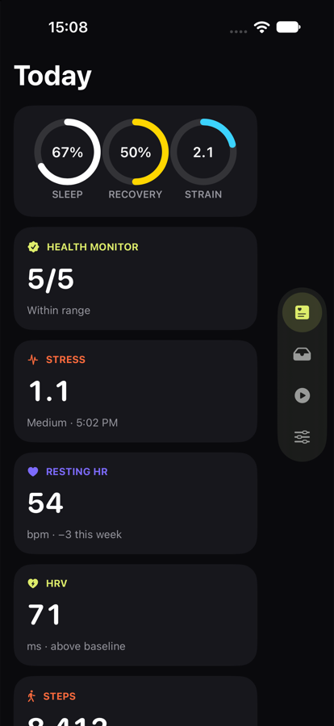
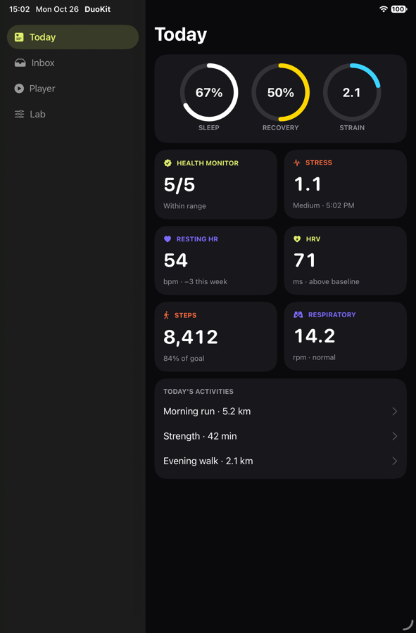
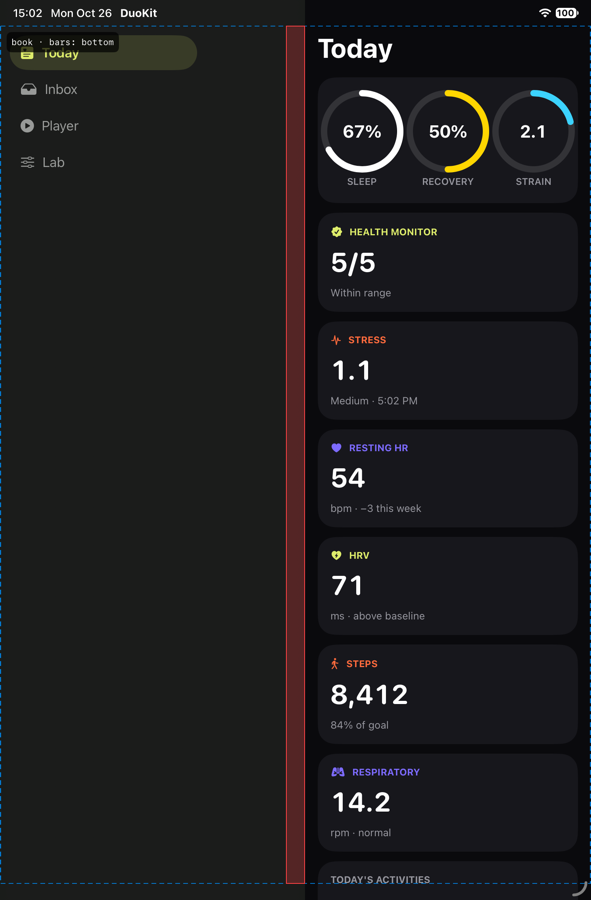
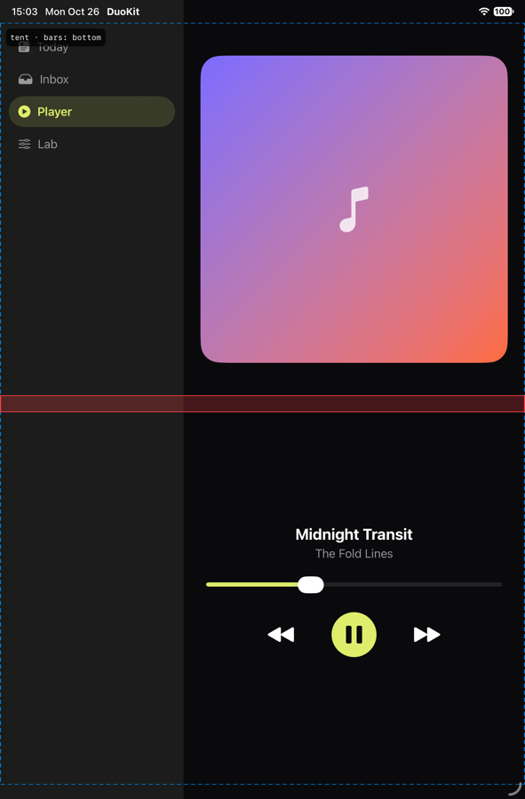

<h1 align="center">DuoKit</h1>

<p align="center">Make your app feel built for iPhone Duo. SwiftUI components that follow Apple's foldable guidelines, folded, open, held like a book, and propped up like a tent.</p>

<p align="center"><a href="https://github.com/shivvyas2/DuoKit/releases/latest">Latest release</a> · <a href="docs/superpowers/specs/2026-10-26-duokit-design.md">Design note</a> · <a href="CONTRIBUTING.md">Contribute</a></p>

<p align="center">
  <a href="https://github.com/shivvyas2/DuoKit/actions/workflows/ci.yml"></a>
  <a href="LICENSE"></a>
  
  
  
  
</p>

<p align="center">
  
  
  
  
</p>

Rebuilding with the iOS 27.1 SDK gets an app out of the letterbox on iPhone Duo's inner display, and Apple's standard containers adapt on their own. Custom UI doesn't. Hand-built tab bars, dashboards, and card grids still look like a stretched phone, and that is most of what makes an app feel unfinished on a foldable. DuoKit gives you those pieces already following the iPhone Duo Human Interface Guidelines, built on Apple's own 27.1 APIs, with no per-pose code in your app.

## What it does

- **One line to start.** `.duoReady()` at the root publishes the posture to every component and turns system tab views into a sidebar on the inner display.
- **Tab bars that move.** `DuoTabShell` keeps your bar's look and puts it where the Duo expects it: along the bottom, as a rail on the edge where the system stands its bars, or as a sidebar that fills the left page when held like a book.
- **Grids that reflow.** `DuoGrid` goes from one or two columns folded to an even count open, and each side of the crease gets its own columns, so no card is ever cut by the fold.
- **Pairs that split.** `DuoSplit` is Apple's `ArrangementView` on 27.1, and side by side or stacked before it.
- **Out of the fold.** `.avoidsFold()` nudges a control just clear of the crease. `DuoTentLayout` puts content above it and controls below.
- **Bars that stand up.** `DuoBar` and `.duoBarInset` lay icon buttons in a row, or a column on the system's bar edge.
- **See what it sees.** `.duoDebugOverlay()` draws the crease, the camera, and the safe area. `.duoSimulate(.book)` fakes any posture on any simulator or preview.
- **duo-lint.** A command-line check for what breaks on the Duo, in Xcode's warning format.

## Requirements

| Tool | Version | Needed for |
| --- | --- | --- |
| Xcode | 27.1 | Building against the iPhone Duo APIs |
| iOS | 17.0 | Deployment target. Duo behaviour switches on with iOS 27.1 |
| Swift | 6.0 | The package |
| xcodegen | 2.x | Only to generate the demo project |

## Install

```swift
dependencies: [
    .package(url: "https://github.com/shivvyas2/DuoKit", from: "0.1.0"),
],
targets: [
    .target(name: "YourApp", dependencies: [.product(name: "DuoKit", package: "DuoKit")]),
]
```

Or in Xcode: File › Add Package Dependencies, and paste the URL.

## Adopt it in an afternoon

**1. One line at the root of each scene.**

```swift
WindowGroup {
    ContentView()
        .duoReady()
}
```

**2. Swap the custom pieces that don't adapt.**

| If you have | Use | What changes on the Duo |
| --- | --- | --- |
| A hand-built tab bar | `DuoTabShell` | Bottom bar folded, a rail when bars stand vertically, a sidebar when open. Keeps your styling. |
| A row of icon buttons | `DuoBar` + `.duoBarInset` | A row normally, a column on the system's bar edge. |
| A card dashboard | `DuoGrid` | 1 to 2 columns folded, an even count open, the crease in a gutter. `.duoGridSpan(.full)` for hero rows. |
| List and detail | `DuoSplit` | `ArrangementView` split on 27.1. Side by side open, stacked folded, before. |
| Buttons near the middle | `.avoidsFold()` | Nudged just clear of the crease when partially folded. |
| Media and controls | `DuoTentLayout` | Content above the crease, controls below, in tent. |

**3. Check your work.**

```swift
ContentView()
    .duoDebugOverlay()   // safe area, crease, camera, posture
    .duoReady()
    .duoSimulate(.book)  // closed, open, book, tent, on any simulator
```

### A custom tab bar, before and after

```swift
DuoTabShell(selection: $tab, tabs: Tab.allCases) { tab in
    page(for: tab)
} item: { tab, context in
    DuoTabLabel(tab.title, systemImage: tab.symbol, context: context)
} chrome: { placement, items in
    items.padding(5).background(.thinMaterial, in: Capsule())  // your bar's look
}
```

`context.placement` tells each item whether it is in the bar, the rail, or the sidebar, so it can drop its title in the rail and sit beside it in the sidebar. If your pages already pad themselves for the bar, pass `bottomBar: .overlaysContent` and read `duoTabPlacement` to pad only while the bar is at the bottom.

## duo-lint

```sh
swift run duo-lint path/to/YourApp
```

```
YourApp/Info.plist:58: warning: [portrait-only] Portrait-only is ignored on the inner display, and people prop the Duo open in landscape.
YourApp/Home.swift:12: error: [main-screen] UIScreen.main is ambiguous on a two-display device and is being deprecated.
duo-lint: 1 error(s), 1 warning(s)
```

| Rule | Severity | Flags |
| --- | --- | --- |
| `main-screen` | error | `UIScreen.main` |
| `idiom-layout` | warning | Layout by `userInterfaceIdiom` |
| `orientation-layout` | warning | Layout by device or interface orientation |
| `fixed-width` | warning | `.frame(width:)` of 300pt or more |
| `portrait-only` | warning | Portrait-only orientations in Info.plist, project.yml, or build settings |
| `requires-full-screen` | warning | `UIRequiresFullScreen` |

It exits 1 on errors, so it can gate CI, and Xcode shows its output inline when run as a build phase.

## Demo

```sh
cd Demo && xcodegen generate && open DuoKitDemo.xcodeproj
```

A health dashboard, a mail split view, a tent-mode player, and a posture lab. Run it on the iPhone Duo simulator and fold it from Device Hub, or on any iPhone or iPad simulator with the Lab tab's posture picker. Launch arguments `-duoSimulate book -duoTab today -duoOverlay YES` start it in a given state.

## Project layout

```
Sources/DuoKitCore/   Layout decisions with no UI: posture, grid columns, fold displacement, tab placement
Sources/DuoKit/       The SwiftUI components. Re-exports DuoKitCore
Sources/DuoLintCore/  duo-lint's rules
Sources/duo-lint/     The command-line entry point
Tests/                Unit tests for the core and the lint rules
Demo/                 The demo app (xcodegen)
docs/superpowers/     Design notes, one per feature
```

Decisions live in `DuoKitCore` as pure functions, so they are tested on the Mac in milliseconds. `DuoKit` only reads the environment and applies them.

## Tests

| Command | Runs | Where |
| --- | --- | --- |
| `swift test` | Core and lint unit tests | Mac or CI |
| `xcodebuild -scheme DuoKit -destination 'generic/platform=iOS Simulator' build` | The components against the iOS SDK | Mac with Xcode 27.1 |
| `swift run duo-lint Sources Demo` | DuoKit linting itself | Mac or CI |

CI runs all three on every push and pull request, plus a secret scan.

## What it's based on

- Apple, [Prepare your app for iPhone Duo](https://developer.apple.com/videos/play/tech-talks/111461/)
- The iPhone Duo Human Interface Guidelines: size classes over poses, vertical bars, split, reflow, and sidebar on the inner display, displacement away from the fold, tent layouts
- iOS 27.1 SDK: `ArrangementView`, `ReservedRegion`, `onHingeChange`, `toolbarVerticalEdge`, `defaultTabBarPlacement`

## Contributing

Contributions are welcome. Read [CONTRIBUTING.md](CONTRIBUTING.md): one branch per change, conventional commits, a design note for anything larger than a fix, and the tests above before you open a pull request. Security issues go through [SECURITY.md](SECURITY.md).

## License

[MIT](LICENSE)
